<div align="center">

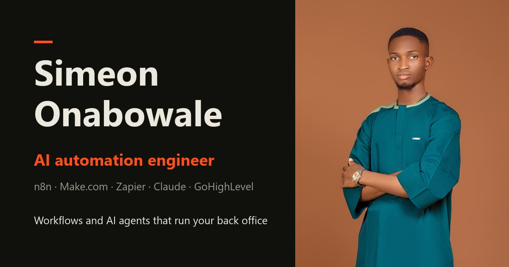

<br><br>

<a href="#-workflows-you-can-watch-run"></a>

**I build AI agents, chatbots, n8n workflows and GoHighLevel systems<br>that take the repetitive work off your team and make sure no lead slips through.**

<sub>For coaches · consultants · medical centres · law offices · real estate teams</sub>

<br>

<a href="https://wa.me/2348110117004"></a>
<a href="mailto:simeono.automation@gmail.com"></a>
<a href="https://www.upwork.com/freelancers/~012e9a6098279f78fc"></a>

<br><br>


</div>

<br>

<table>
<tr>
<td align="center" width="20%"><h2>14</h2><sub>page closing packet from one title binder PDF</sub></td>
<td align="center" width="20%"><h2>82</h2><sub>state-form fields filled per packet</sub></td>
<td align="center" width="20%"><h2>$0.35</h2><sub>AI cost to check a binder</sub></td>
<td align="center" width="20%"><h2>1,000+</h2><sub>businesses researched in one run</sub></td>
<td align="center" width="20%"><h2>8:00<sup>am</sup></h2><sub>daily digest of what is missing</sub></td>
</tr>
</table>

<br>

## ▶ Workflows you can watch run

> **Demo builds.** Real n8n workflows, run for real, with made-up sample data.
> Texts and emails go to a test outbox instead of being sent. Each one has a screen recording of a real run.

<table>
<tr>
<td width="33%" valign="top">
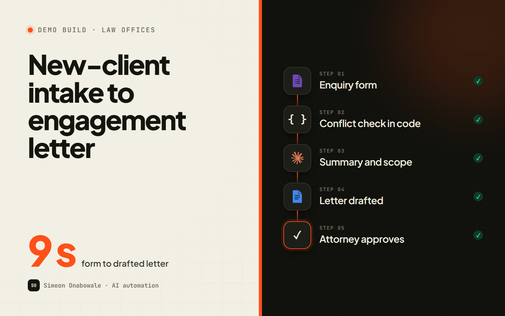<br>
<sub><code>LAW OFFICES</code></sub><br>
<b>New-client intake to engagement letter</b><br>
<sub>Conflict check in code, summary by Claude, letter drafted, attorney approves.</sub><br>
<a href="site/assets/work/demo-law.mp4">▶ Watch the run</a>
</td>
<td width="33%" valign="top">
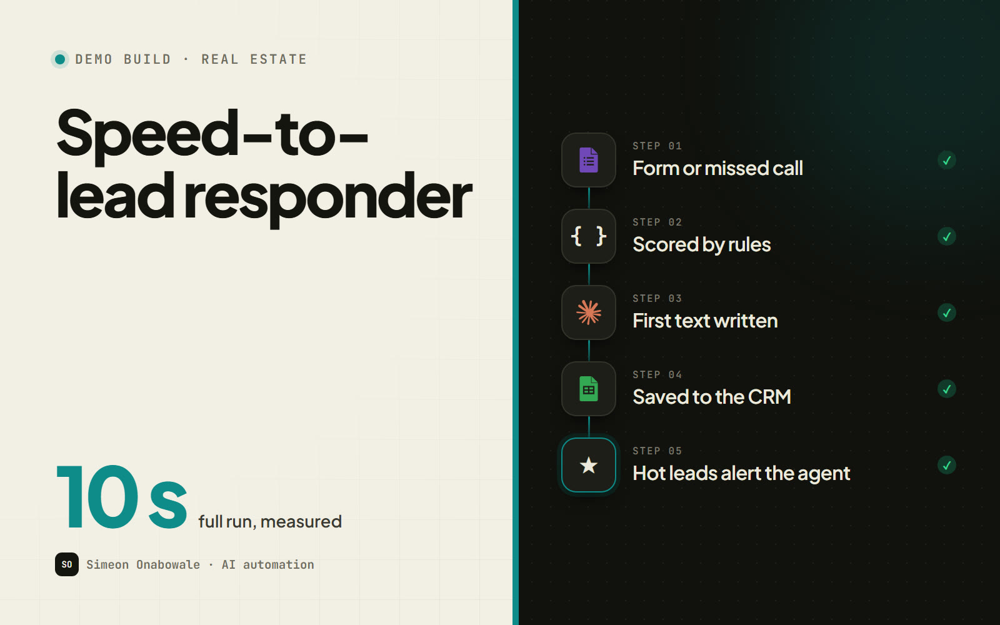<br>
<sub><code>REAL ESTATE</code></sub><br>
<b>Speed-to-lead responder</b><br>
<sub>A personal text back, a score the agent can read, an alert when the lead is hot.</sub><br>
<a href="site/assets/work/demo-realestate.mp4">▶ Watch the run</a>
</td>
<td width="33%" valign="top">
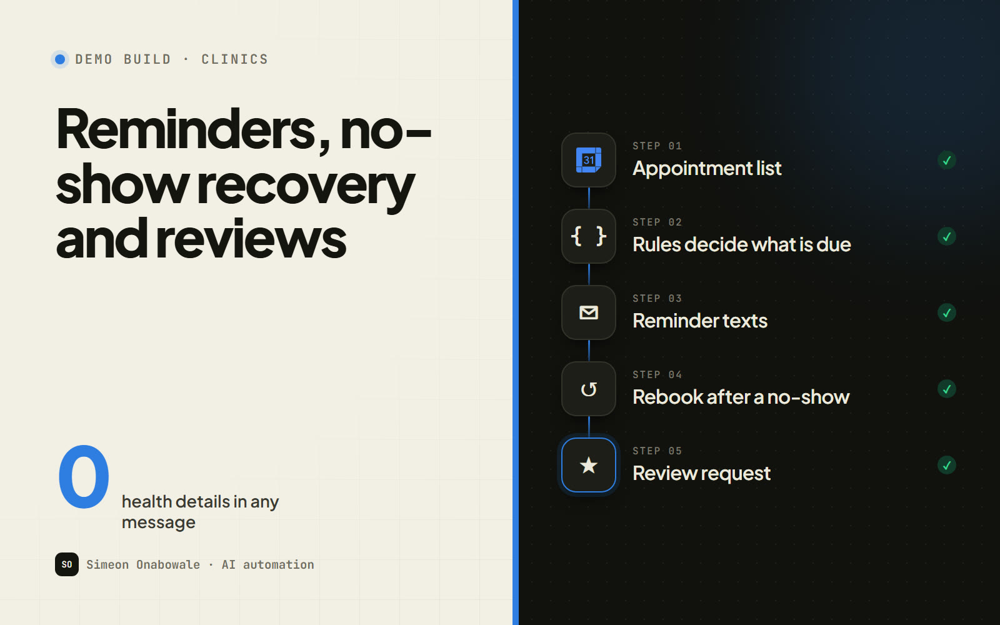<br>
<sub><code>CLINICS</code></sub><br>
<b>Reminders, no-show recovery and reviews</b><br>
<sub>Plain rules, no AI, and no health details in any message.</sub><br>
<a href="site/assets/work/demo-clinic.mp4">▶ Watch the run</a>
</td>
</tr>
<tr>
<td width="33%" valign="top">
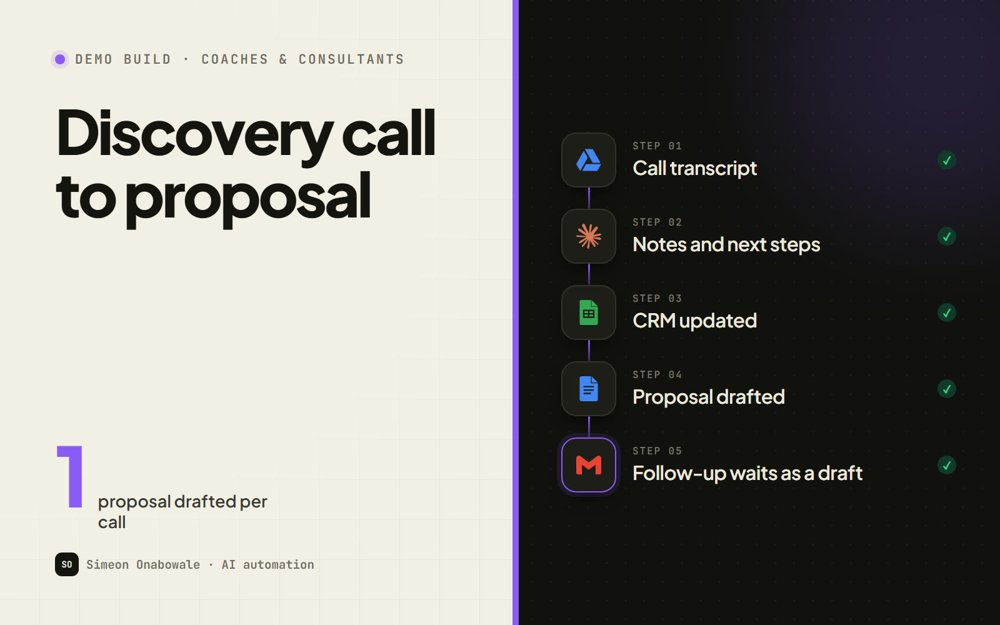<br>
<sub><code>COACHES &amp; CONSULTANTS</code></sub><br>
<b>Discovery call to proposal</b><br>
<sub>Transcript in, notes, CRM update and a drafted proposal out.</sub><br>
<a href="site/assets/work/demo-coach.mp4">▶ Watch the run</a>
</td>
<td width="33%" valign="top">
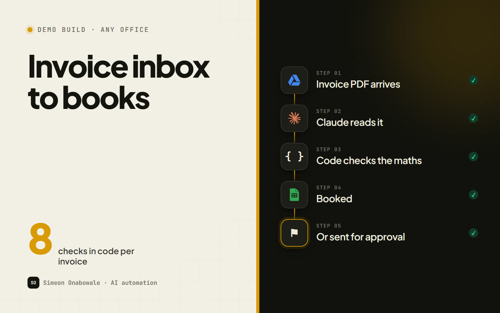<br>
<sub><code>ANY OFFICE</code></sub><br>
<b>Invoice inbox to books</b><br>
<sub>AI reads the invoice, code checks the maths, odd ones wait for approval.</sub><br>
<a href="site/assets/work/demo-invoices.mp4">▶ Watch the run</a>
</td>
<td width="33%" valign="top">
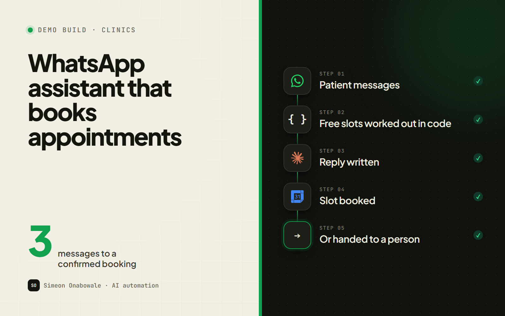<br>
<sub><code>CLINICS</code></sub><br>
<b>WhatsApp assistant that books appointments</b><br>
<sub>Three messages to a confirmed booking, from slots that are really free.</sub><br>
<a href="site/assets/work/demo-whatsapp.mp4">▶ Watch the run</a>
</td>
</tr>
<tr>
<td width="33%" valign="top">
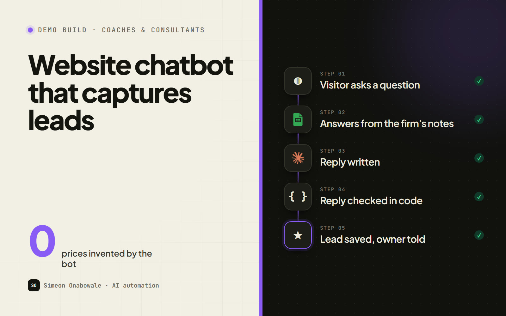<br>
<sub><code>COACHES &amp; CONSULTANTS</code></sub><br>
<b>Website chatbot that captures leads</b><br>
<sub>Answers from the firm's own notes and never quotes a price.</sub><br>
<a href="site/assets/work/demo-webchat.mp4">▶ Watch the run</a>
</td>
<td width="33%" valign="top">
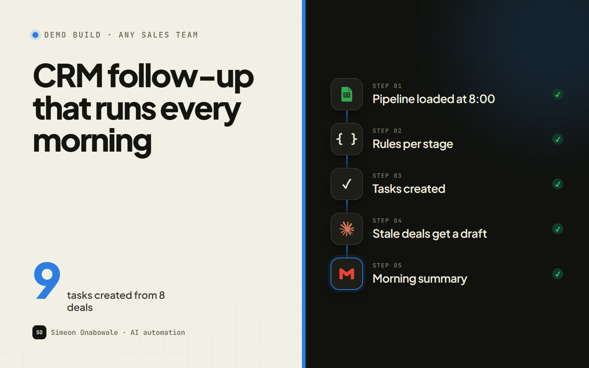<br>
<sub><code>ANY SALES TEAM</code></sub><br>
<b>CRM follow-up that runs every morning</b><br>
<sub>A next step on every deal, tasks created, quiet deals get a drafted follow-up.</sub><br>
<a href="site/assets/work/demo-crm.mp4">▶ Watch the run</a>
</td>
<td width="33%" valign="top" align="center">
<br><br><br>
<b>Want one like these?</b><br>
<sub>Tell me what you do by hand today.</sub><br><br>
<a href="https://wa.me/2348110117004"></a>
</td>
</tr>
</table>

<br>

## ● Live with clients

> Systems that are in daily use for real teams. Names are kept private, and every number comes from the running system.

<table>
<tr>
<td width="33%" valign="top">
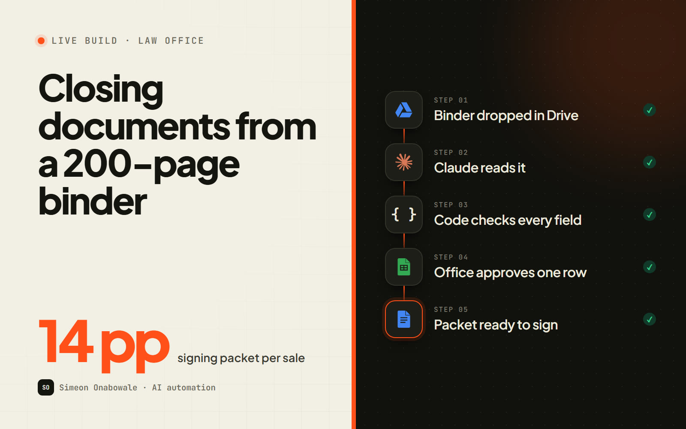<br>
<sub><code>LEGAL · LIVE</code></sub><br>
<b>Closing documents drafted from a 200-page title binder</b><br>
<sub>A binder goes in a folder; a signing-ready 14-page packet comes out.</sub><br>
<a href="site/assets/work/closing-n8n.mp4">▶ Real recording</a>
</td>
<td width="33%" valign="top">
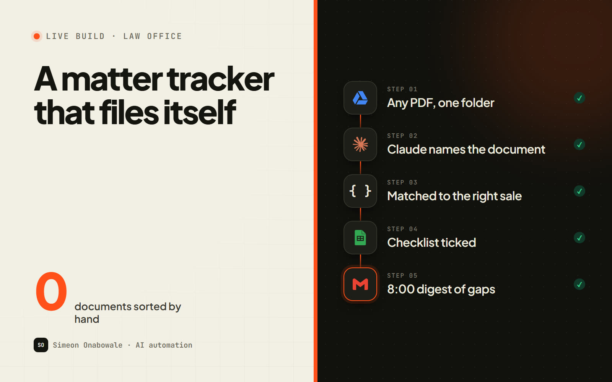<br>
<sub><code>LEGAL · LIVE</code></sub><br>
<b>A matter tracker that files every document by itself</b><br>
<sub>Any PDF, one folder. Claude files it and an 8:00 digest lists the gaps.</sub>
</td>
<td width="33%" valign="top">
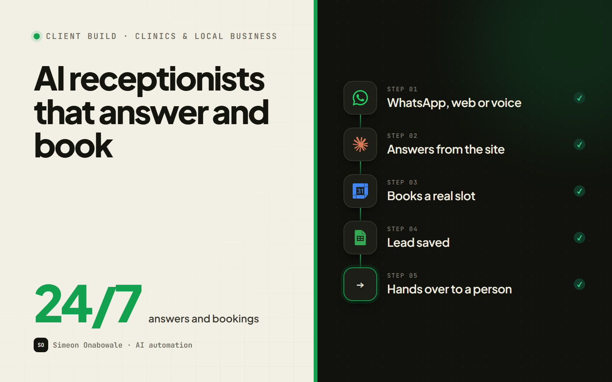<br>
<sub><code>AI CHAT · VOICE</code></sub><br>
<b>AI receptionists for clinics and local businesses</b><br>
<sub>WhatsApp, website and voice, set up from one config.</sub>
</td>
</tr>
<tr>
<td width="33%" valign="top">
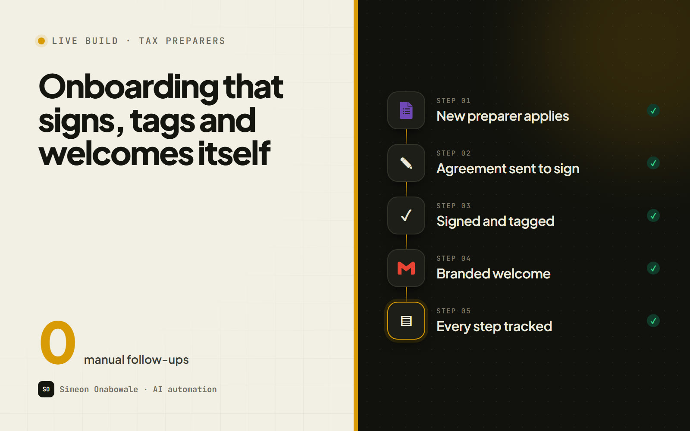<br>
<sub><code>GOHIGHLEVEL · LIVE</code></sub><br>
<b>Tax-preparer onboarding that signs, tags and welcomes itself</b><br>
<sub>Agreement, e-signature and a branded welcome, every step tracked.</sub>
</td>
<td width="33%" valign="top">
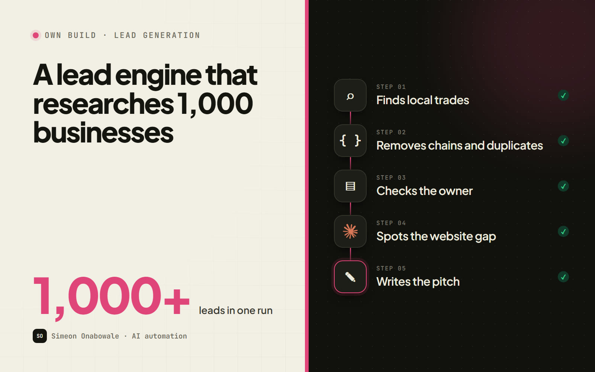<br>
<sub><code>LEAD GEN · CLAUDE CODE</code></sub><br>
<b>A lead engine that researches 1,000 businesses a run</b><br>
<sub>Finds the business, checks the owner, spots the gap, writes the pitch.</sub>
</td>
<td width="33%" valign="top">
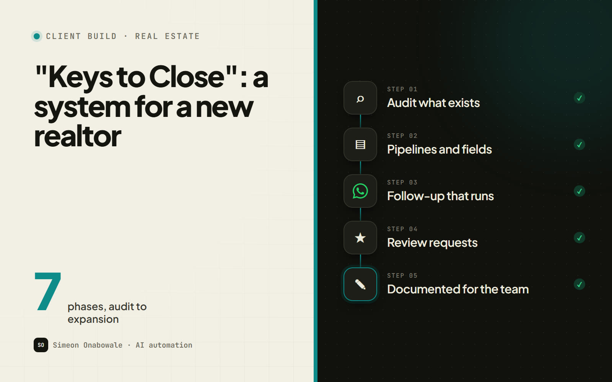<br>
<sub><code>REAL ESTATE · GOHIGHLEVEL</code></sub><br>
<b>"Keys to Close": a GoHighLevel system for a new realtor</b><br>
<sub>Seven phases from audit to expansion, documented for her team.</sub>
</td>
</tr>
</table>

<br>

## ✦ What I build, and what you get

| | Service | What it covers |
|:-:|---|---|
| `01` | **Document & data pipelines** | PDFs, contracts and forms read by AI, checked in code, turned into filled templates, sheets or CRM records |
| `02` | **n8n workflow builds** | From one integration to multi-branch systems with retries, error workflows and alerts |
| `03` | **AI agents & assistants** | WhatsApp, website and voice assistants that answer, qualify and book, with a human hand-off |
| `04` | **GoHighLevel systems** | Pipelines, fields, tags, workflows, forms, contracts and email templates, set up and documented |
| `05` | **Lead generation engines** | Research, qualification and personalised first lines at volume |
| `06` | **Rescues & audits** | Automations that fail silently or were left behind: diagnosed, fixed and documented |

<br>

## ⚙ How I work

<table>
<tr>
<td width="25%" valign="top"><h3>01</h3><b>Map it before I build it</b><br><sub>I learn how the work really happens and say plainly where automation pays and where it doesn't.</sub></td>
<td width="25%" valign="top"><h3>02</h3><b>AI reads, code checks</b><br><sub>Claude reads and sorts. Amounts, dates and legal fields are validated in code before anything is written.</sub></td>
<td width="25%" valign="top"><h3>03</h3><b>Fail loudly, never silently</b><br><sub>Retries, duplicate guards and an alert path. You hear about a problem before your client does.</sub></td>
<td width="25%" valign="top"><h3>04</h3><b>You own all of it</b><br><sub>It runs on your accounts, with a written guide, test results and a walkthrough.</sub></td>
</tr>
</table>

<br>

## ◎ Works with the tools you already use

<div align="center">


</div>

<br>

## ★ What clients say after the handover

<table>
<tr>
<td width="50%" valign="top">
★★★★★<br><br>
<i>"Simeon was professional and took the effort to explain and design the workflow. I will recommend him. We have actually worked together multiple times."</i><br><br>
<b>Tim Yu</b> · <sub>Repeat client</sub>
</td>
<td width="50%" valign="top">
★★★★★<br><br>
<i>"Helpful and good communication throughout the project. He took time to understand the requirement and did additional research to deliver on my expectations. Much appreciated."</i><br><br>
<b>Adele Mailan</b> · <sub>Extra mile</sub>
</td>
</tr>
<tr>
<td width="50%" valign="top">
★★★★★<br><br>
<i>"I can say nothing other than that Simeon does excellent work. I highly recommend working with them. Simeon, once again thank you, you are amazing!"</i><br><br>
<b>Mink</b> · <sub>Went above &amp; beyond</sub>
</td>
<td width="50%" valign="top">
★★★★★<br><br>
<i>"An excellent worker that deserves more work. Communication was clear and he made sure he heard every detail. I can't wait to work with him again, I'll definitely be back!"</i><br><br>
<b>Lucrecia Paz</b> · <sub>Will return</sub>
</td>
</tr>
</table>

<br>

## ☺ About me


I'm **Simeon Onabowale**, an AI automation engineer based in **Lagos, Nigeria**. I build n8n, Make.com and Zapier workflows, Claude-powered AI agents and chatbots, and GoHighLevel systems for teams in the US, UK and EU.

Most of my work is for law offices, real estate teams, clinics, coaches and consultants: the document reading, lead follow-up and data entry that eats a team's week. Every build runs on your own accounts and comes with a written handover guide, so you own it and you're never locked in to me.

<br clear="left">

<br>

---

<details>
<summary><b>🛠 For developers: what is in this repository</b></summary>

<br>

| Folder | What it holds |
|---|---|
| `site/` | The portfolio website. Plain HTML, CSS and JavaScript, no build step |
| `site/door/` | An owner-only page for changing the site's name, colours and text |
| `server/` + `netlify/` | The small backend behind that page (Netlify Function + Netlify Blobs) |
| `workflows/` | The eight demo n8n workflows, ready to import, with no account IDs in them |
| `showcase-workflows/` | The script that generates those workflows, sample files and the demo chat screens |
| `covers/` | The script that draws the cover graphics |

**Run it on your computer**

```bash
node dev-server.mjs
```

Then open `http://localhost:5176`.

**Deploy**

Netlify, publishing the `site` folder (already set in `netlify.toml`). Set an `ADMIN_PASSWORD` environment variable for the owner page.

</details>

<div align="center">

<br>


<sub>© 2026 Simeon Onabowale · AI automation engineer</sub>

</div>
